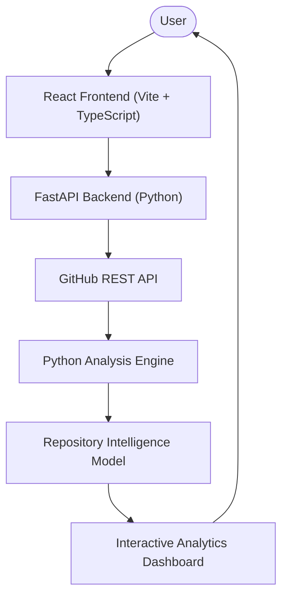

# RepoLens

## GitHub Repository Intelligence Platform

> Explore the architecture, activity, contributors, dependencies, and health indicators of any public GitHub repository.

---

## Overview

**RepoLens** is an interactive web platform designed to analyze public GitHub repositories and transform raw repository telemetry into an engaging visual and analytical experience. By synthesizing metadata, file system structures, version control histories, and collaboration metrics, RepoLens helps engineers, maintainers, and curious developers gain immediate structural clarity on any open-source codebase.

The application evaluates key software dimensions including programming language breakdown, commit velocity, contributor dynamics, dependency ecosystem manifests, directory trees, open issues and pull requests, and multi-factor repository health indicators.

Through a cohesive blend of rich web visuals and focused analytical tools, RepoLens turns repository exploration from static code browsing into an intuitive structural discovery process.

---

## Key Features

* **🔎 Repository Analysis** — Instant parsing and inspection of any public GitHub repository URL or `owner/repo` path.
* **📊 Visual Analytics** — Interactive charts and metric summaries illustrating code distribution, velocity, and project cadence.
* **👥 Contributor Insights** — Contributor leaderboards highlighting commit shares, contribution patterns, and team collaboration.
* **📝 Commit Intelligence** — Commit timeline breakdowns and recency signals tracking development activity over time.
* **💻 Language Analysis** — Multi-language distribution calculations with precise byte counts and percentage breakdowns.
* **📦 Dependency Detection** — Automated detection and categorization of manifest dependencies across popular package ecosystems.
* **🌳 Repository Structure** — Interactive hierarchical file tree visualization displaying codebase organization and directory composition.
* **❤️ Repository Health Indicators** — Multi-dimensional scoring evaluating documentation presence (README, License, Contributing, Code of Conduct), commit cadence, issue responsiveness, and maintenance indicators.
* **🏰 Interactive 3D Experience** — An exploratory 3D digital fortress environment rendered in real-time with WebGL and React Three Fiber.
* **🤖 Repository Guardians & Archivists** — Original mechanical guardian avatars representing distinct analytical duties: *The Cartographer*, *The Astrolabe*, *The Chronicler*, and *The Archivist*.
* **🎨 Scroll-Based Storytelling** — Fluid scroll transitions and cinematic narrative pacing powered by Framer Motion.
* **💬 Natural Language Inquiries** — In-dashboard querying system allowing developers to ask focused questions about the analyzed repository.

---

## Product Experience

RepoLens adopts an imaginative **digital fortress** metaphor to represent the inner architecture and health of a software project:

1. **Enter the Repository** — Submit any public repository path through the exploratory portal.
2. **Explore the Digital Fortress** — Experience a 3D architectural representation of the codebase.
3. **Analyze Repository Data** — Parallel backend analyzers fetch, normalize, and score repository dimensions.
4. **Discover Structural Telemetry** — Inspect commits, contributors, dependencies, file trees, and health indicators.
5. **Explore the Intelligence Dashboard** — Interact with modular data cards, language meters, health grades, and query assistants.

---

## Architecture

---

## Technology Stack

| Layer | Technologies |
| :--- | :--- |
| **Frontend UI & State** | React, TypeScript, Vite, Tailwind CSS |
| **Animation & Graphics** | Framer Motion, Three.js, React Three Fiber, Lucide Icons, Canvas Confetti |
| **Data Visualization** | Recharts |
| **Backend API** | Python, FastAPI, Uvicorn, Pydantic |
| **Data Extraction & Client** | PyGithub, HTTPX, Python-Dateutil |

---

## Analysis Modules

| Module | Purpose |
| :--- | :--- |
| **Repository Metadata** | Extracts core repository properties including stars, forks, watchers, license, and default branch. |
| **Languages** | Quantifies language distribution and calculates percentage weights across the codebase. |
| **Commits** | Evaluates commit history, recent cadence, and development velocity over time. |
| **Contributors** | Ranks contributor activity and visualizes collaboration distribution. |
| **Dependencies** | Scans project manifests (`package.json`, `requirements.txt`, `pyproject.toml`, `Cargo.toml`, `go.mod`, `pom.xml`, etc.) to surface project dependencies. |
| **Structure** | Builds an interactive hierarchical directory tree to inspect repository layout and file types. |
| **Issues & PRs** | Analyzes issue counts, pull request activity, and open-to-closed ratios. |
| **Health Indicators** | Computes transparent health scores across documentation, maintenance, and community standards. |

---

## Design & Aesthetics

RepoLens combines technical clarity with a stylized visual identity:

* **Watercolor-Inspired Environment** — Soft, warm parchment tones, deep forest slates, and antique brass accents.
* **Digital Fortress Metaphor** — Represents software artifacts as enduring architectural structures.
* **Mechanical Repository Guardians** — Custom SVG automaton characters (*Cartographer*, *Astrolabe*, *Chronicler*, *Archivist*) guiding the analytical pipeline.
* **Cinematic Scroll Transitions** — Layered animation stages delivering a seamless narrative progression.
* **Analytical Developer UI** — High-contrast data widgets, legible typography, and responsive chart layouts.

---

## Screenshots

*Screenshots will be added as the project interface is finalized.*

<!--
### Landing Experience

### 3D Digital Fortress

### Repository Analysis

### Health Indicators

### Commit Analytics

### Contributor Visualization

### Dependency Visualization

-->

---

## Project Status

**🚧 In Development**

RepoLens is an actively developed developer tool and portfolio project. Continuous improvements to analysis depth, visualization fidelity, and performance are currently underway.

---

## Roadmap

The following enhancements are planned for future development:

* [ ] Repository comparison (side-by-side architectural evaluations)
* [ ] Historical repository snapshots and trend tracking
* [ ] Scheduled monitoring and change notifications
* [ ] Expanded ecosystem manifest analyzers
* [ ] Deep dependency vulnerability and license compliance scanning
* [ ] GitHub organization-wide aggregation and health rollups
* [ ] Exportable executive intelligence reports (PDF / JSON)

---

## License

This project is available under the MIT License. See the [LICENSE](LICENSE) file for details.
